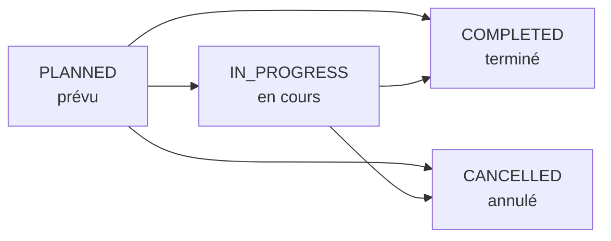

# Vue d'ensemble

Retour à [[00 - Garage (accueil)]].

## Qui utilise l'app ? (les rôles)
L'app est un outil **interne** au garage : il n'y a pas de portail client. Seuls des membres du garage ont un compte.

| Rôle | Ce qu'il peut faire |
|---|---|
| **ADMIN** | Tout : clients, véhicules, rendez-vous, devis, factures, pièces, comptes utilisateurs |
| **EMPLOYEE** (employé) | Gérer clients, véhicules, rendez-vous, devis, factures, pièces |
| **CLIENT** | *Existe dans le code* (accès limité à ses propres rendez-vous/véhicules) mais **n'est pas utilisé en pratique** : personne ne s'inscrit soi-même, aucun compte CLIENT n'est créé dans le fonctionnement réel du garage. Le rôle reste disponible si un portail client est ajouté un jour. |

Le menu ne montre que les pages autorisées pour le rôle ([[05 - Sécurité]]).

## Cycle de vie d'un compte employé
Il n'y a **aucune inscription publique** : la page `/register` a été retirée (elle ne créait que des comptes CLIENT, inutiles ici). Un seul chemin pour obtenir un compte :
1. Un **ADMIN** crée le compte depuis la page **Comptes** : prénom, nom, e-mail, mot de passe, rôle (EMPLOYEE par défaut). Ce mot de passe est le « code » que l'admin transmet au nouvel employé.
2. Si l'employé part, l'ADMIN le **désactive** (bouton sur la même page) : son accès est coupé immédiatement, y compris s'il était déjà connecté (la connexion active est révoquée, voir [[05 - Sécurité]]). L'historique (rendez-vous, factures) qu'il a créés reste intact : on désactive, on ne supprime jamais le compte.

## Les pages
- **Accueil / Dashboard** : chiffres et graphiques (statuts des rendez-vous, marques les plus fréquentes, chiffre d'affaires par mois, pièces en stock bas)
- **Clients** et **Véhicules** : liste, fiche détaillée, historique des rendez-vous
- **Rendez-vous** : un **calendrier** (jour, semaine, mois) avec **glisser-déposer** pour déplacer un rendez-vous
- **Pièces** : catalogue, stock, seuil d'alerte, délai de livraison, journal des mouvements ([[12 - Pièces et stock]])
- **Factures** : liste, détail, PDF, paiement, bouton « Générer les factures », page des erreurs du batch
- **Comptes** : créer des utilisateurs, choisir leur rôle, activer/désactiver (réservé à ADMIN, sauf la lecture ouverte à EMPLOYEE)
- **Paramètres** : langue (FR / EN), thème de couleurs
- Pages publiques : connexion, mot de passe oublié / réinitialisation (plus de page d'inscription)

## Le cycle de vie d'un rendez-vous

`COMPLETED` et `CANCELLED` sont **finaux** : on ne les modifie plus.

## Devis puis facture
1. Un rendez-vous peut avoir **un devis** (des lignes : description, quantité, prix unitaire). Une ligne peut être une **pièce du catalogue** (réserve du stock, voir [[12 - Pièces et stock]]) ou de la main-d'œuvre / texte libre (sans pièce liée).
2. Le devis est `DRAFT` (brouillon), puis `ACCEPTED` ou `REFUSED`. Un devis n'est **jamais supprimé** : on le refuse.
3. Quand le rendez-vous est `COMPLETED` **et** le devis `ACCEPTED`, une **facture** peut être créée (une seule par rendez-vous). Elle est `ISSUED` (émise) puis `PAID` (payée).

## Règles du planning
- Durée d'un rendez-vous : de 15 à 480 minutes, **par pas de 15**.
- Le garage a une **capacité** (3 rendez-vous en même temps par défaut) : au-delà, le serveur refuse (erreur 409).
- Un **même véhicule** ne peut pas avoir deux rendez-vous qui se chevauchent.
- Seuls les rendez-vous `PLANNED` peuvent être déplacés.
- Plaque au format SIV : `AA-123-AA`.
