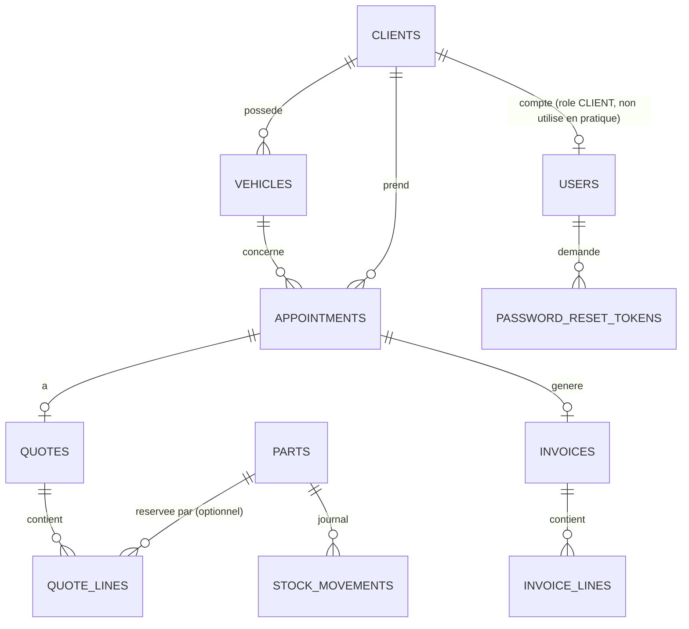

# Base de données

Retour à [[00 - Garage (accueil)]].

## Les tables

- `clients`, `vehicles` (plaque unique), `appointments` (date, motif, statut, durée)
- `quotes` + `quote_lines` (une ligne peut référencer `part_id`, nullable) ; `invoices` + `invoice_lines`
- `parts` (référence unique, prix, stock, seuil d'alerte, délai de livraison en jours, verrou optimiste `version`) + `stock_movements` (journal IN/OUT/ADJUSTMENT, voir [[12 - Pièces et stock]])
- `users` (e-mail unique, mot de passe **haché**, rôle, langue, `token_version` pour révoquer une session, voir [[05 - Sécurité]])
- `password_reset_tokens` (on ne stocke que le **hash** du jeton)
- `batch_errors` : les refus du job de facturation
- Une **séquence** `invoice_number_seq` donne les numéros `FAC-AAAA-000001`

## Contraintes qui protègent les données
- `UNIQUE` sur `invoices.appointment_id` : **impossible** d'avoir deux factures pour un rendez-vous, même par accident.
- Clés étrangères : on ne peut pas créer un rendez-vous pour un client qui n'existe pas.
- Montants en `numeric(12,2)` (jamais de nombres flottants pour de l'argent).

## Liquibase : versionner la base
Les modifications de structure ne se font pas à la main : elles sont écrites dans des fichiers (`001-init.yaml`, `002-evolutions.yaml`, `003-invoices.yaml`). Au démarrage, **Liquibase** applique ceux qui manquent. Résultat : tout le monde a la même base.

Hibernate (JPA) est réglé sur `ddl-auto: validate` : il **vérifie** que les tables correspondent au code mais ne les modifie jamais.

## Calcul d'une ligne
`total de ligne = quantité × prix unitaire`, arrondi à 2 décimales (arrondi « HALF_UP » : 0,005 monte). Le total d'un devis ou d'une facture est la **somme des lignes arrondies**. Voir [[10 - Problèmes rencontrés]] (écart d'un centime).
