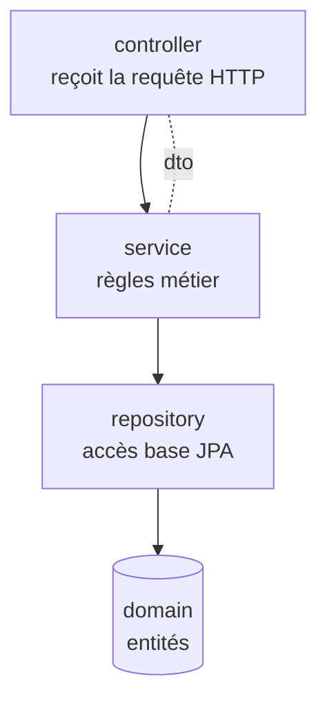

# Back-end Spring Boot

Retour à [[00 - Garage (accueil)]].

## Technologies
Java 21, Spring Boot 3.3, Maven. Dépendances principales : Web, Data JPA, Security, Validation, Batch, Mail, Freemarker, Liquibase, PostgreSQL, JJWT (jetons), openhtmltopdf (PDF), springdoc (Swagger).

## Les couches (un dossier chacune)

| Dossier | Rôle |
|---|---|
| `controller` | Expose les URL (`/api/...`), vérifie les rôles avec `@PreAuthorize` |
| `service` | **Toutes les règles** (capacité, chevauchements, transitions de statut) |
| `repository` | Requêtes vers la base (Spring Data JPA, quelques requêtes natives) |
| `domain` | Les entités (Client, Vehicle, Appointment, Quote, Invoice, User...) et les enums de statut |
| `dto` | Les objets échangés avec le front (on n'expose pas les entités directement) |
| `security` | Filtre JWT, jeton, utilisateur courant |
| `config` | Sécurité, CORS, propriétés, création de l'administrateur initial |
| `exception` | Erreurs métier traduites en réponses HTTP propres |
| `batch` | Le job de facturation ([[07 - Facturation et Spring Batch]]) |
| `util` | Outils (ex. normalisation de plaque) |

## Les URL principales
| Zone | Exemples |
|---|---|
| Authentification | `POST /api/auth/login`, `/logout`, `GET /api/auth/me`, mot de passe oublié/réinitialisé. `/register` existe mais est réservé à `ADMIN` (plus d'inscription publique, voir [[01 - Vue d'ensemble]]) |
| Clients / véhicules | `GET/POST/PUT /api/clients`, `/api/clients/{id}/vehicles`, `/api/vehicles` |
| Rendez-vous | `GET /api/appointments`, `GET /calendar`, `PATCH /{id}/status`, `PATCH /{id}/reschedule` |
| Devis | `/api/appointments/{id}/quote` |
| Pièces | `GET/POST/PUT /api/parts`, `POST /{id}/stock` (ajuster), `GET /{id}/movements` (journal), `POST /{id}/activate` |
| Factures | `GET /api/invoices`, `GET /{id}/pdf`, `PUT /{id}/pay` |
| Batch | `POST /api/invoices/batch/run`, `GET /runs`, `GET /errors` |
| Comptes | `GET/POST /api/users` (création réservée `ADMIN`), `/{id}/role`, `/{id}/client` |
| Statistiques | `/api/dashboard`, `/api/statistics/...` |
| Exports Excel | `/api/exports/clients.xls`, `appointments.xls`, `invoices.xls` |

## Réponses d'erreur
Les règles refusées renvoient un code clair : **400** (donnée invalide / règle), **404** (introuvable), **409** (conflit : capacité atteinte, véhicule déjà pris), **401/403** (droits).

## Configuration par variables d'environnement
Rien de secret dans le code : `DB_URL`, `DB_USER`, `DB_PASSWORD`, `JWT_SECRET`, `ADMIN_EMAIL`, `ADMIN_PASSWORD`, `FRONT_URL`, `COOKIE_SECURE`, `GARAGE_CAPACITY`... lues par `application.yml`. Le port vient de `PORT` (imposé par Render).

## Premier administrateur
Au démarrage, `AdminInitializer` crée un administrateur **seulement s'il n'y en a aucun**, à partir de `ADMIN_EMAIL` / `ADMIN_PASSWORD`.

## Tests
JUnit 5 + **Testcontainers** : les tests d'intégration lancent un vrai PostgreSQL temporaire dans Docker, donc ils vérifient la vraie base, pas une imitation.

## E-mails et PDF
- Les factures PDF sont générées depuis un **modèle HTML Freemarker** puis converties par openhtmltopdf.
- Les e-mails (mot de passe oublié...) passent par `spring-boot-starter-mail`. Sur Render gratuit, le SMTP sortant est **bloqué** : ces e-mails ne partent pas en ligne.
