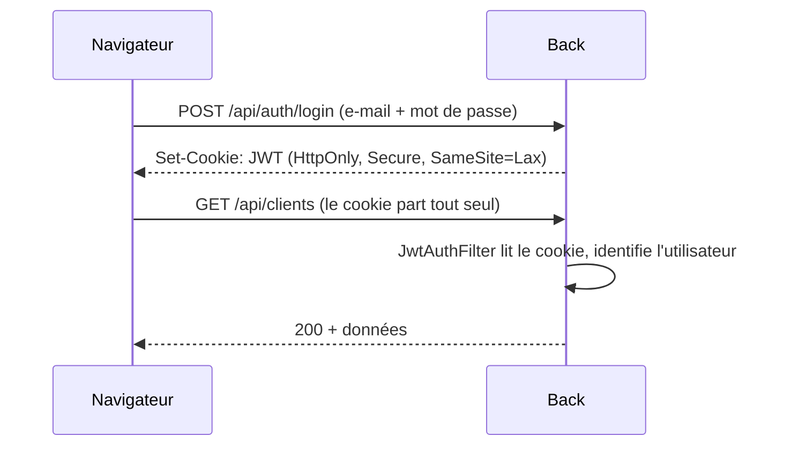

# Sécurité

Retour à [[00 - Garage (accueil)]].

## 1. Mots de passe
Jamais stockés en clair : on garde un **hash BCrypt** (impossible à « décoder », mais comparable).

## 2. Connexion avec un JWT dans un cookie

- Un **JWT** est un jeton signé qui contient l'identifiant de l'utilisateur. Le serveur le vérifie sans session en mémoire (mode **stateless**).
- Il est dans un cookie **HttpOnly** : le JavaScript de la page ne peut pas le lire, donc un script malveillant ne peut pas le voler.
- `Secure` : le cookie ne voyage qu'en HTTPS. `SameSite=Lax` : il n'est pas envoyé depuis un autre site pour les actions qui modifient.

## 3. CSRF : protéger les actions qui modifient
Attaque CSRF : un site pirate pousse ton navigateur à envoyer une requête à l'app, avec ton cookie.
Défense **double-submit cookie** :
1. Le serveur pose un cookie lisible `XSRF-TOKEN`.
2. Pour toute requête qui modifie (POST, PUT, PATCH, DELETE), Angular copie sa valeur dans l'en-tête `X-XSRF-TOKEN`.
3. Le serveur compare. Un site pirate ne peut pas lire ce cookie, donc ne peut pas fabriquer l'en-tête.
Les routes de connexion/inscription sont exemptées (pas encore de session à protéger).

Un bug lié à ce cookie est expliqué dans [[10 - Problèmes rencontrés]].

## 4. Rôles
`@EnableMethodSecurity` + `@PreAuthorize("hasAnyRole('ADMIN','EMPLOYEE')")` sur les contrôleurs. Un client n'accède qu'à **ses** données (le service filtre sur son `clientId`).

## 5. CORS
Le back n'accepte les appels que depuis l'adresse du front (`FRONT_URL`), avec cookies autorisés.

## 6. Limiter les tentatives de connexion (rate limiting)
`LoginAttemptService` (en mémoire, par IP + e-mail) : 5 échecs bloquent la paire 1 minute, les 5 suivants 5 minutes, puis 15 minutes. Remis à zéro à la première connexion réussie. Réponse **429** avec l'en-tête `Retry-After`.
- *Limite connue* : en mémoire, donc remis à zéro si le serveur redémarre, et ne fonctionnerait pas tel quel avec plusieurs instances du back-end en parallèle (il faudrait alors un stockage partagé comme Redis).

## 7. Révoquer une session volée (déconnexion forcée)
Chaque utilisateur a un `token_version` (en base). Le JWT porte cette valeur. Changer son mot de passe l'incrémente : **tous** les jetons émis avant deviennent invalides d'un coup, même s'ils étaient encore utilisés ailleurs. Même mécanisme quand un `ADMIN` désactive un compte (`enabled=false`), vérifié à chaque requête.

## 8. Empêcher de deviner quels comptes existent (énumération)
Se connecter avec un e-mail inconnu répondait **instantanément** (pas de calcul), alors qu'un mauvais mot de passe sur un compte réel prenait ~100 ms (le temps de BCrypt). Cet écart de temps suffisait à deviner quels e-mails existent. Correction : un e-mail inconnu est maintenant comparé à un **hash BCrypt factice**, calculé au démarrage, pour prendre le même temps dans tous les cas.

## 9. Mot de passe minimum
12 caractères minimum à l'inscription et à la réinitialisation (8 avant). Pas de règle de complexité en plus : la longueur compte plus que les caractères spéciaux imposés.

## 10. Audit de sécurité (13 novembre 2026)
Un audit volontaire a été mené en se mettant à la place d'un attaquant : lecture du code, puis tentatives réelles contre une instance locale. Toutes les décisions de correction ont été prises explicitement par le responsable du projet, jamais seul par l'assistant IA — c'est une règle de collaboration du projet sur les sujets de sécurité.

### Ce qui a été testé en conditions réelles, et qui a résisté
| Test | Outil | Résultat |
|---|---|---|
| Deviner le mot de passe admin (dictionnaire de 500 mots de passe très courants) | Script maison, puis **Hydra** (outil de pentest standard) en 8 threads parallèles | **Échec** : 0 trouvé sur 499 essais. Le mot de passe réel n'est dans aucune liste de mots courants. |
| Falsifier un jeton JWT pour usurper l'identité de l'admin (`alg: none`, puis payload modifié avec l'ancienne signature recyclée) | Jetons fabriqués à la main | **Échec** : 401 dans les deux cas. La bibliothèque JWT refuse l'algorithme `none`, et la signature ne correspond plus dès que le contenu change. |
| Casser la clé de signature JWT hors ligne (Hashcat, mode 16500) | Hashcat | Abandonné (lenteur de l'installation du runtime CPU dans le conteneur), sans conclusion. À refaire si besoin d'une vraie garantie. |
| Créer un compte avec un rôle élevé via l'inscription publique | `POST /api/auth/register` sans compte admin | Possible à l'époque (créait un compte `CLIENT`, le rôle le moins privilégié) — ce chemin n'existe plus, `/register` est maintenant réservé `ADMIN` |

### Failles trouvées puis corrigées
| # | Faille | Avant | Après |
|---|---|---|---|
| 1 | Pas de limite sur les tentatives de connexion | Un script pouvait essayer des milliers de mots de passe sans jamais être bloqué | `LoginAttemptService` : blocage progressif par IP + e-mail (voir §6) |
| 2 | Swagger accessible sans connexion sur la pile Docker locale | `/v3/api-docs` répondait 200 à n'importe qui, révélant toute la carte de l'API | Swagger désactivé par variables d'environnement dédiées (`SPRINGDOC_API_DOCS_ENABLED=false`), **sans** activer tout le profil `prod` (qui aurait aussi forcé un cookie `secure`, incompatible avec cette pile en HTTP simple) |
| 3 | Une session volée (cookie copié) restait valide jusqu'à son expiration, même après un changement de mot de passe | Jusqu'à 30 jours de fenêtre d'exploitation (« se souvenir de moi ») | `token_version` : changer le mot de passe invalide instantanément toutes les anciennes sessions (voir §7) |
| 4 | Dépassement d'entier dans la réservation de stock d'un devis | 50 lignes de quantités énormes pouvaient faire déborder le calcul et, par effet de bord, ajouter du stock au lieu d'en retirer | Somme calculée en `long`, refus explicite au-delà de 100 000 unités (`QuoteStockService`) |
| 5 | Énumération des comptes par le temps de réponse à la connexion | Voir §8 | Voir §8 |
| 6 | Pas d'en-têtes de sécurité sur le front (nginx) | Aucune protection contre le détournement de clic (clickjacking), pas de `nosniff` | `X-Frame-Options: DENY`, `X-Content-Type-Options: nosniff`, `Referrer-Policy` ajoutés dans `nginx.conf` |
| 7 | Mot de passe trop court (8 caractères, sans liste noire) | `12345678` était accepté | 12 caractères minimum (voir §9) |

### Pas de trace des tentatives de connexion échouées
Avant l'audit, aucune ligne de journal n'enregistrait un échec de connexion : 499 tentatives d'affilée ne laissaient **aucune trace** consultable. Corrigé dans `AuthService` : chaque échec écrit `WARN ... Failed login attempt for <e-mail>` (jamais le mot de passe), chaque succès écrit une ligne `INFO`.

### Un incident non lié au code : deux PostgreSQL sur le même volume
Pendant les tests, deux conteneurs PostgreSQL différents (`garage-postgres`, mode IntelliJ, et `garage-app-postgres`, pile Docker Compose complète) ont tourné **en même temps** sur le **même volume de données** (`backend_garage-pgdata`), ce que le commentaire du fichier `docker-compose.yml` déconseillait déjà explicitement. Résultat : un PostgreSQL a invalidé le fichier verrou de l'autre, qui s'est arrêté brutalement, laissant des doublons fantômes dans le catalogue système (`pg_dump` plantait avec `cache lookup failed`). Réparation : sauvegarde table par table (`COPY ... TO STDOUT`, qui ne touche pas au catalogue abîmé), nouvelle base vide, reconstruction du schéma par Liquibase, réimport. **À retenir : ne jamais lancer les deux piles PostgreSQL en même temps.**
