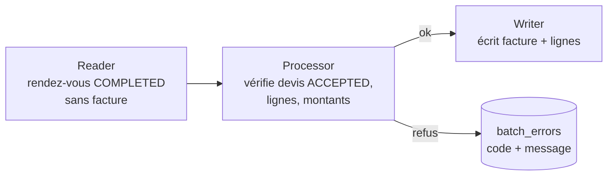

# Facturation et Spring Batch

Retour à [[00 - Garage (accueil)]].

## Le besoin
Créer **une facture par rendez-vous terminé**, sans jamais de doublon, et savoir pourquoi certains rendez-vous sont refusés.

## Pourquoi Spring Batch ?
Un **batch** traite beaucoup d'éléments d'un coup, avec un journal de ce qui a réussi ou échoué. Spring Batch fournit ce cadre.

## Les règles du processeur
- Le rendez-vous doit être `COMPLETED`.
- Il faut un devis `ACCEPTED` (sinon erreur `NO_ACCEPTED_QUOTE`).
- Les lignes actives doivent avoir des montants valides ; le **total du devis doit égaler la somme des lignes** (sinon « Montant invalide »).
- Le numéro `FAC-AAAA-000001` vient d'une **séquence PostgreSQL**. Une séquence n'est pas transactionnelle : un numéro pris puis non utilisé n'est jamais réutilisé (des trous sont possibles, et c'est normal).

## Sécurité contre les doublons
- Le reader ne sélectionne que les rendez-vous **sans** facture.
- La base impose `UNIQUE (appointment_id)` sur `invoices`.
- Relancer le job est donc **sans danger** (idempotent).
- Un verrou empêche deux lancements en même temps (réponse 409 « déjà en cours »).

## Lancement
`POST /api/invoices/batch/run` (bouton « Générer les factures ») : le job tourne **de façon synchrone** et rend un résumé. La page « Erreurs du batch » liste chaque refus avec son rendez-vous et un message clair.

Sur le plan gratuit Render, environ 1 000 factures prennent plus d'une minute ; la page peut sembler figée, c'est normal.
