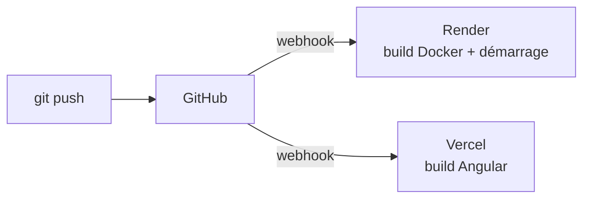

# Déploiement (gratuit)

Retour à [[00 - Garage (accueil)]].

## Où est quoi ?
| Pièce | Hébergeur | Détail |
|---|---|---|
| Front Angular | **Vercel** (offre Hobby, gratuite) | Build `ng build`, fichiers statiques |
| Back Spring Boot | **Render** (Web Service gratuit, Docker) | Région Frankfurt, 512 Mo de RAM |
| Base PostgreSQL | **Render** (Postgres gratuit) | 1 Go, **expire après 30 jours** |
| Code | **GitHub** (dépôt privé) | Branche de travail déployée automatiquement |

Pourquoi pas Railway ? Les inscriptions y étaient fermées au moment du projet.

## Le flux de déploiement

À chaque `git push`, Render et Vercel reconstruisent tout seuls (Auto-Deploy).

## Back-end sur Render
1. **Base** : créer un Postgres. Render ajoute un **suffixe aléatoire** au nom de la base : il faut utiliser le nom exact affiché.
2. **Service web** : type Docker, *Root Directory* = `backend`, *Dockerfile Path* relatif à ce dossier.
3. **Variables d'environnement** (les secrets se saisissent dans Render, jamais dans Git) :
   - `SPRING_PROFILES_ACTIVE=prod`, `COOKIE_SECURE=true`, `TZ=Europe/Paris`
   - `DB_URL` au format **JDBC** : `jdbc:postgresql://<hôte-interne>:5432/<nom-exact>` (l'URL `postgres://` de Render ne marche pas en Java)
   - `DB_USER`, `DB_PASSWORD`, `JWT_SECRET`, `ADMIN_EMAIL`, `ADMIN_PASSWORD`
4. On utilise l'adresse **interne** de la base (plus rapide, sans exposition publique).

### Le Dockerfile (2 étapes)
1. Image Maven + JDK 21 : compile le projet en un fichier `.jar`.
2. Image légère JRE 21 : copie le `.jar`, tourne avec un utilisateur **non-root**.
Réglages mémoire pour 512 Mo : `-XX:MaxRAMPercentage=65`, GC série, `-Xss512k`, arrêt si mémoire saturée.

## Front-end sur Vercel
- Dossier racine : `frontend`. `vercel.json` définit la commande de build et la sortie `dist/frontend/browser`.
- À la compilation, l'adresse d'API `http://localhost:8080` est **remplacée par du vide** (commande `sed`) : le front appelle simplement `/api/...`.
- **Réécritures** dans `vercel.json` :
  - `/api/:path*` → le serveur Render
  - tout le reste → `/index.html` (pour que les routes Angular marchent au rechargement)

## Pourquoi ce proxy est précieux
Le navigateur ne voit **qu'un seul site**. Les cookies de connexion et CSRF restent « du même site » et fonctionnent normalement. Sans lui, il faudrait régler SameSite=None, CORS et cookies tiers, souvent bloqués par les navigateurs.

## Limites du gratuit à connaître
- Le serveur Render **s'endort après 15 min** d'inactivité : la première requête met ~1 minute.
- Le disque est **éphémère** (rien d'important ne s'y écrit).
- L'envoi d'e-mails (SMTP) est **bloqué** : mot de passe oublié inopérant en ligne.
- La base gratuite **expire** après 30 jours (il faut la recréer ou passer en payant).
- Vercel Hobby : usage non commercial.
