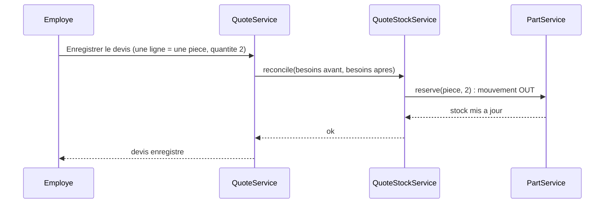

# Pièces et stock

Retour à [[00 - Garage (accueil)]].

## À quoi ça sert
Le garage a un catalogue de pièces (plaquettes, filtres...) avec un stock. Un devis peut utiliser une pièce du catalogue : le stock baisse automatiquement, et remonte si la pièce n'est plus utilisée. L'objectif : que le stock affiché corresponde toujours à la réalité, sans geste manuel supplémentaire pour l'employé qui fait le devis.

## Le modèle : quantité + journal
Chaque pièce (`parts`) a une quantité en stock (`quantity_in_stock`). Elle **ne change jamais directement** : tout changement passe par un mouvement, écrit dans le journal (`stock_movements`), avec un type :
- **IN** : entrée (livraison), quantité strictement positive.
- **OUT** : sortie, quantité strictement positive (soustraite du stock).
- **ADJUSTMENT** : correction d'inventaire, différence **signée** (peut être négative), jamais zéro.

Dans tous les cas, le stock résultant ne peut jamais devenir négatif : refusé avec une erreur claire.

## Réservation par un devis

- Une ligne de devis est **soit** une pièce du catalogue (`part_id` renseigné, quantité entière obligatoire), **soit** de la main-d'œuvre / texte libre (`part_id` vide).
- À l'enregistrement du devis, seule la **différence** entre l'ancien besoin et le nouveau est appliquée (augmenter une quantité de 2 à 5 ne réserve que 3 de plus, pas 5).
- Le stock remonte automatiquement (mouvement IN) quand : une ligne pièce est retirée, le devis est refusé, ou le rendez-vous est annulé. Un devis déjà refusé ne libère pas une deuxième fois si son rendez-vous est annulé après coup (`QuoteService.changeStatus`).
- Si le stock manque, **rien n'est enregistré** (toute l'opération échoue) et le message dit combien de temps le fournisseur met à livrer (`lead_time_days` sur la pièce, 0 = inconnu) :
  > *« BRK-001 : 3 en stock, 5 demandés, à commander, livraison en environ 4 jours »*

## Décisions prises (et pourquoi)
Ces choix ont été posés explicitement par le responsable du projet, pas décidés seul par l'assistant IA (sécurité et règles métier) :
| Question | Décision | Alternative écartée |
|---|---|---|
| Quand réserver le stock ? | Dès l'**enregistrement** du devis (brouillon) | À l'acceptation du devis (le stock serait resté « libre » trop longtemps, risque de double réservation) |
| Comment représenter le stock réservé ? | Mouvements immédiats dans le journal existant (le stock affiché = stock disponible) | Un champ `reservedQuantity` séparé (plus précis mais plus de code et de cas à gérer) |
| Pièce manquante ? | Délai fixe affiché (`leadTimeDays`), pas de suivi de commande | Un vrai système de commandes fournisseur (plus complet, mais c'est une deuxième fonctionnalité entière) |
| Lien devis ↔ pièce | Obligatoire pour une ligne « pièce » : pas de pièce hors catalogue sur un devis | Lien facultatif ou pas de lien du tout |

## Le dashboard
Le nombre de pièces actives au stock au ou sous le seuil d'alerte (`countLowStock`, requête dédiée car on ne peut pas comparer deux colonnes avec une requête dérivée Spring Data) est affiché sur l'accueil, avec un raccourci vers la page Pièces.

## Un bug trouvé et corrigé : dépassement d'entier
Sommer les quantités de 50 lignes de devis en `int` pouvait déborder (50 × ~10⁸ dépasse 2,1 milliards, la limite d'un `int` Java) et donner un résultat **aberrant et silencieux** — potentiellement une sortie de stock qui se transforme en entrée. Corrigé : la somme se fait en `long`, avec un refus explicite au-delà de 100 000 unités (`QuoteStockService.toSafeInt`). Détail dans [[05 - Sécurité]].

## Fichiers
- Back-end : `domain/Part.java`, `domain/StockMovement(Type).java`, `service/PartService.java`, `service/QuoteStockService.java`, `controller/PartController.java`, migrations `013` à `016` (`db/changelog/004-stock.yaml`).
- Front-end : `pages/parts/`, le sélecteur de pièce dans `pages/appointments/` (formulaire du devis).
